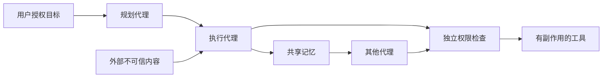

# 多智能体威胁建模框架

## 1. 系统与资产

画出代理、工具、共享记忆、外部数据源和人类操作者，标出读写能力及网络连接。保护对象包括私密数据、凭证、用户目标、工具权限、任务结果、计算预算和审计记录。

图是待分析架构的示例。每条跨信任边界的边都需要单独描述；不能默认图中的权限检查已经正确实现。

## 2. 信任边界

| 边界 | 需要回答的问题 |
| --- | --- |
| 外部内容 → 代理上下文 | 内容来源与信任等级是否保留？ |
| 代理 A → 代理 B | 身份、消息完整性与数据语义如何分别处理？ |
| 代理 → 共享记忆 | 谁可写入、谁可修改来源、污染如何撤销？ |
| 规划代理 → 工具代理 | 委派权限是否明确、最小化、有期限？ |
| 代理 → 有副作用工具 | 是否由独立执行层校验参数与授权？ |
| 系统 → 人类审批 | 审批展示的是原始证据还是被污染的摘要？ |

## 3. 攻击者能力

明确控制几个代理、多少消息或文档，是否拥有合法身份，能否读私密信息、写共享记忆、修改工具定义或改变拓扑。记录攻击轮次、查询预算、自适应能力和目标。

将“恶意用户直接提出危险请求”“第三方间接注入”“合法代理被攻陷”“多个代理主动串谋”分开建模。固定其中一个条件后再比较防御。

## 4. 从入口到最终影响

使用链路：**入口 → 第一次信任边界跨越 → 传播/持久化 → 权限检查 → 可观察副作用**。

例：检索文档包含不可信指令 → worker 将它写成建议 → planner 转述为任务 → 工具代理收到超出用户授权的操作 → 执行层拒绝或实际执行。这个示例用于设计测试，不代表已经在本仓库复现的漏洞。

## 5. 控制与残余风险

逐个边界考虑来源标记、结构化指令/数据通道、最小权限、能力令牌、写入隔离、预算限制、终止条件、人工授权、撤销和恢复。为每个控制写出“依赖什么假设、能阻止什么、什么仍然可能失败”。

依据 [CaMeL](https://arxiv.org/abs/2503.18813) 与 [Can CaMeLs Talk?](https://arxiv.org/abs/2610.05640)，优先检查控制流/数据流分离和跨代理来源保留；依据 [CORBA](https://arxiv.org/abs/2502.14529)，单独检查可用性。分层分析可参考 [MAESTRO](https://cloudsecurityalliance.org/blog/2025/02/06/agentic-ai-threat-modeling-framework-maestro)，协议实现参考 [MCP 安全实践](https://modelcontextprotocol.io/docs/2025-11-25/tutorials/security/security_best_practices)和 [A2A 企业安全能力](https://a2a-protocol.org/latest/topics/enterprise-ready/)。

具体记录使用[威胁模型模板](../templates/THREAT_MODEL.md)。
